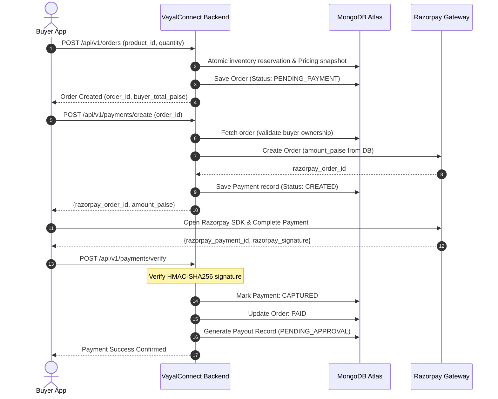
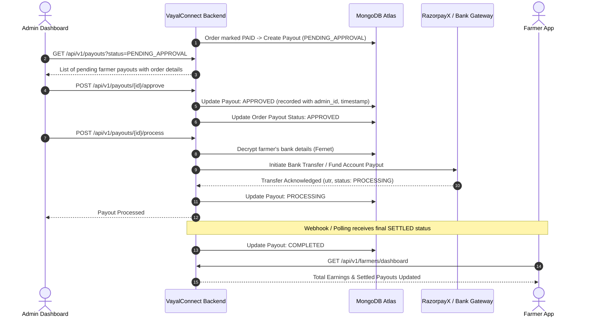

# VayalConnect — Payment & Payout Architecture

This document describes the complete lifecycle of money across the VayalConnect platform, from Buyer checkout through Razorpay payment gateway to Admin approval and Farmer payout (via RazorpayX).

---

## 1. Core Financial Rules & Invariants

1. **Integer Paise Only**: Every amount in the backend is represented and stored as an integer number of paise (`1 INR = 100 paise`). Floats are strictly prohibited.
2. **Platform Balance Invariant**:
   $$\text{Buyer Total} = \text{Farmer Payout} + \text{Platform Commission}$$
   This invariant is verified before persisting any product snapshot or finalizing any order.
3. **Server-Side Price Authority**: The mobile app NEVER submits prices or totals. All calculations occur inside `app.services.pricing_service.PricingEngine`.
4. **Idempotency**: All payment verifications and payout requests use cryptographically unique idempotency keys.

---

## 2. Buyer Payment Flow (Razorpay PG)

---

## 3. Farmer Payout Flow (RazorpayX / Bank Transfer)

Payouts are **NOT** automated directly upon buyer payment to prevent fraud, dispute mismanagement, or defective crop delivery. Payouts require an audited Admin approval workflow:

---

## 4. Razorpay Webhook Idempotency

When Razorpay triggers asynchronous webhook events (e.g. `payment.captured` or `payout.processed`):
1. The backend verifies the `X-Razorpay-Signature` against `RAZORPAY_WEBHOOK_SECRET`.
2. The payload's event ID is evaluated against existing records to discard duplicate deliveries.
3. If the payment was already captured by the synchronous verify endpoint, the webhook exits cleanly without secondary side effects.
